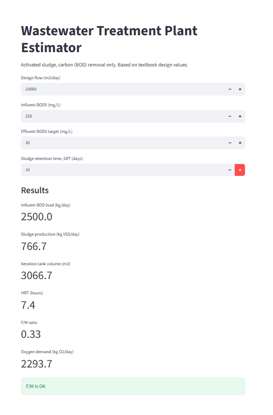
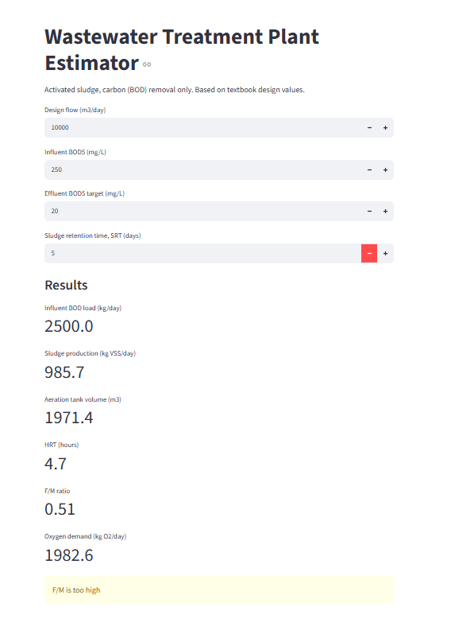

# Wastewater Treatment Plant Estimator
A small Python tool that automates the first design calculations for a municipal activated sludge plant (BOD removal only). Built as a personal portfolio project during my M.Sc. in Business Intelligence and Data Science. My background is in process engineering, where I prepared design calculations for water and wastewater treatment plant tenders.

**Live app:** https://wwtp-estimator.streamlit.app/



## What it does
Enter the design flow, influent BOD, effluent target and sludge retention time (SRT). The tool calculates:
- influent BOD load and removed load (kg/day)
- sludge production (kg VSS/day)
- aeration tank volume (m3) and hydraulic retention time (hours)
- F/M ratio, with a warning when it is outside the typical range of 0.2 to 0.4
- oxygen demand (kg O2/day)



Example: with a shorter SRT of 5 days instead of 10, the tank gets smaller (1971 m3 instead of 3067 m3), but the F/M ratio rises to 0.51 and the tool warns that the plant would be overloaded.

## Formulas
- Load (kg/day) = flow x concentration / 1000
- Observed yield: Y_obs = Y / (1 + kd x SRT)
- Sludge production = Y_obs x removed load
- Tank volume = SRT x sludge production x 1000 / MLVSS
- F/M = flow x influent BOD / (volume x MLVSS)
- Oxygen demand = removed load / 0.68 - 1.42 x sludge production

## Project structure
- `mass_balance.py`: the calculation functions
- `test_mass_balance.py`: automatic tests (pytest) based on a worked example
- `app.py`: the Streamlit web app
- `requirements.txt`: required packages

## How to run
```
pip install -r requirements.txt
python -m pytest
python -m streamlit run app.py
```

## Limitations
- Simplified model for educational purposes: carbon removal only, no nitrogen or phosphorus removal, no costing.
- Design parameters (yield 0.6, decay 0.08, MLVSS 2500 mg/L, BOD5/BODu 0.68) are typical public textbook values. This tool is not intended for real plant design.
- No proprietary data, templates or design standards from any employer were used.

## Tools
Python, pytest, Streamlit
